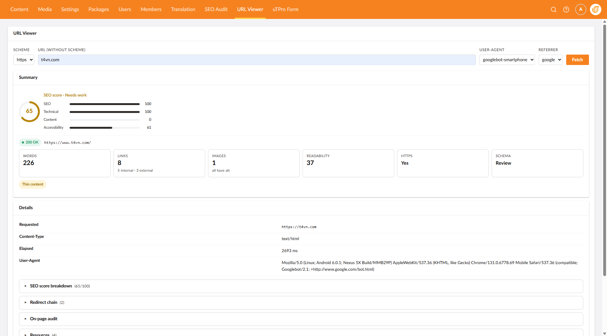

# uTPro URL Viewer for Umbraco

Fetch any URL from inside the Umbraco backoffice and see **exactly** what a search engine or browser sees — redirect chain, response headers, HTML source, and a full static analysis including a **composite SEO score**.

Supports **Umbraco 16, 17 and 18**.

[](https://www.nuget.org/packages/uTPro.Feature.UrlViewer)
[](https://www.nuget.org/packages/uTPro.Feature.UrlViewer)
[](https://marketplace.umbraco.com/package/utpro.feature.urlviewer)
[](https://umbraco.com)
[-green.svg)](LICENSE.txt)



## What it does

Installing this package adds a **URL Viewer** section to the backoffice navigation. Users assigned to the section get a single **URL Viewer** tab.

### URL Viewer tab

Enter any URL, pick the scheme (HTTP/HTTPS), user agent and referrer, then fetch. You get:

- **Full redirect chain** — every hop with status code and raw response headers.
- **HTML source viewer** — line numbers, word-wrap toggle, copy-to-clipboard, spam-word highlighting.
- **Composite SEO score (0–100)** — Lighthouse-style checklist with per-category sub-scores (SEO / Technical / Content / Accessibility) and individual check pass/fail + remediation advice.
- **On-page SEO analysis** — title, meta description, canonical, H1/H2/H3 list, `noindex` / `nofollow`, `lang`.
- **Social tags** — Open Graph and Twitter Card, social-profile links, pixel detection (Facebook, Twitter, LinkedIn, Google Analytics).
- **Technical SEO** — charset, gzip/br compression, browser caching, HTTPS, schema.org markup, viewport, favicon.
- **Content metrics** — word and paragraph count, Flesch readability, keyword density, thin-content flag.
- **Accessibility subset** — aria-label / aria-describedby counts, skip-to-content link, heading structure, inputs missing a label.
- **Carbon estimate** — CO₂e per page view with an A–F rating.
- **Spam / hidden-CSS / JavaScript analysis** — common hack injection patterns, hidden elements, `eval` / `document.write` / base64 obfuscation and more.
- **Cloaking detection** — compares what the bot sees versus what Chrome sees (title, status code, content-size difference).
- **VirusTotal link** for the fetched domain.

### REST API

Every fetch is also available as an authenticated JSON API (`POST /umbraco/management/api/v1/utpro/url-viewer/fetch`) — useful for CI pipelines or external tooling. The response includes the full `analysis.audit` object and the `seoScore`.

## Architecture

This package is built on the framework-agnostic [**T4VN.Seo.Core**](https://www.nuget.org/packages/T4VN.Seo.Core) engine, which provides the fetch pipeline, all analysis and `SeoScorer` — the single source of truth for the SEO score. Both this package and the companion site crawler ([`uTPro.Feature.SEOAudit`](https://www.nuget.org/packages/uTPro.Feature.SEOAudit)) share the same engine, so scores are identical everywhere.

```
T4VN.Seo.Core  (engine, no Umbraco)
      ▲                  ▲
      │                  │
uTPro.Feature.UrlViewer  uTPro.Feature.SEOAudit
(this package)           (site-wide crawler — optional companion)
```

## Install alongside the SEO Audit

If you also install [`uTPro.Feature.SEOAudit`](https://www.nuget.org/packages/uTPro.Feature.SEOAudit),
its **Site Audit** and **Error URLs** dashboards appear in the same **SEO Audit** section, and a per-node
**SEO Audit** tab is added to every Content/Media editor. Each package works independently — install
only what you need.

## Security

All API endpoints are backoffice-secured under `/umbraco/management/api/v1/utpro/...` and require
Settings-section access. Server-side fetches run behind an **SSRF guard** that blocks private/local
addresses (RFC-1918, localhost, `.local`, CGNAT, link-local, IPv6 ULA/loopback) and re-checks on
every redirect hop.

## Installation

```bash
dotnet add package uTPro.Feature.UrlViewer
```

## Configuration

No configuration is required for the URL Viewer tool itself. If you need to fetch internal/dev hosts:

```json
{
  "uTPro": {
    "Feature": {
      "UrlViewer": {
        "AllowInternalHosts": false,
        "AllowInvalidCertificates": false
      }
    }
  }
}
```

| Key | Default | Description |
|-----|---------|-------------|
| `AllowInternalHosts` | `false` | Relax the SSRF guard to allow fetching private/local addresses. Only for internal dev sites. |
| `AllowInvalidCertificates` | `false` | Accept self-signed / invalid TLS certificates. Only for internal dev sites. |

## Building the package

```powershell
pwsh ./pack.ps1
```

Wipes `bin`/`obj`, clean `Release` pack into `Build/`, evicts the version from the local NuGet cache.

## Repository layout

```
uTPro.Feature.UrlViewer.Src/
├─ src/
│  ├─ uTPro.Feature.UrlViewer/          # NuGet package
│  └─ uTPro.Feature.UrlViewer.TestSite/ # demo Umbraco site
├─ pack.ps1
└─ uTPro.Feature.UrlViewer.sln
```

## License

Free to use (including commercially) under a proprietary [End User License Agreement](LICENSE.txt).
Distributed as a compiled NuGet package — source is not published; modification, reverse-engineering
and redistribution are not permitted.
