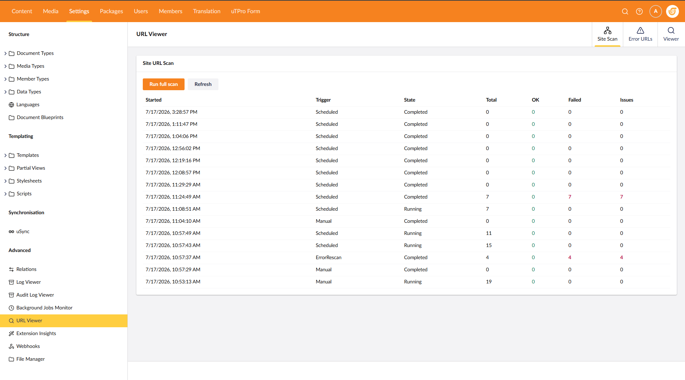
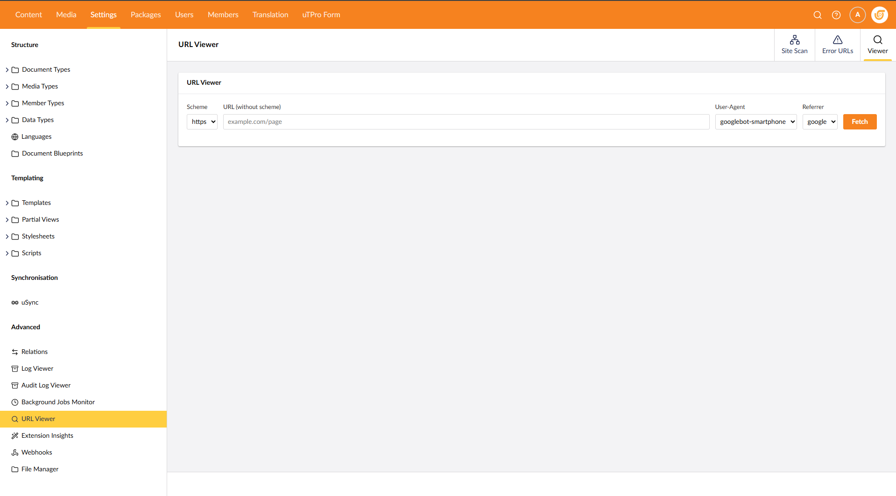
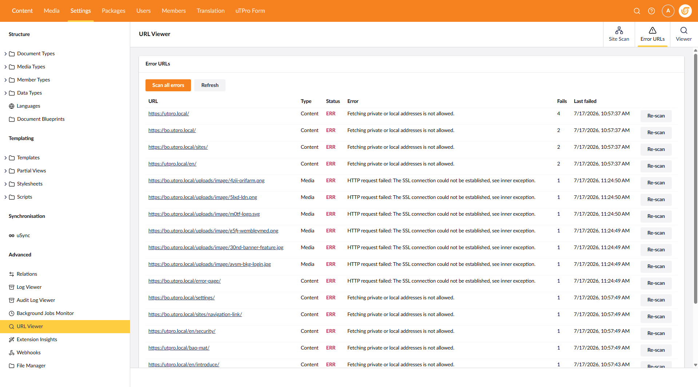

# uTPro SEO Audit for Umbraco

> Formerly **uTPro URL Viewer**. Same package (`uTPro.Feature.UrlViewer`), now a full SEO & site auditor.

Crawl and audit your whole site for **SEO**, **broken links, images and resources**, **accessibility**, **content quality** and **carbon** — with a per-run **health score**, prioritised **issues**, per-page detail and **CSV export**, right in the Umbraco backoffice. Also includes a **fetch as Googlebot / Bingbot** URL Viewer tool for inspecting the redirect chain, response headers, HTML source, cloaking and spam/hack signals.

Supports **Umbraco 16, 17 and 18**.

[](https://www.nuget.org/packages/uTPro.Feature.UrlViewer)
[](https://www.nuget.org/packages/uTPro.Feature.UrlViewer)
[](https://marketplace.umbraco.com/package/utpro.feature.urlviewer)
[](https://umbraco.com)
[-green.svg)](LICENSE.txt)



## Highlights

- **Whole-site crawl & audit** of every Content and Media URL (plus `sitemap.xml`).
- **Broken link, image and resource** detection with status codes.
- **Rich per-page audit**: SEO, social, technical SEO, content quality, accessibility and carbon.
- **Health score, prioritised issues, orphaned & duplicate detection, CSV export.**
- **Fetch-as-Googlebot URL Viewer** for redirect, header, HTML and cloaking inspection.
- **Runs in the background**, scheduled and on-demand, secured behind the backoffice.

## Site Audit

A recurring background job crawls every **Content** and **Media** URL on the site (and, optionally, URLs found in `sitemap.xml`), then stores a summary report per run — never the full HTML.

- **Broken links, images & resources** — every `<a>`, `` and stylesheet/script/font is checked for a valid status code (and size); 4xx/5xx are recorded per page and listed in the report.
- **Health score per run** plus an **Overview** of totals (pages, links, images, resources, broken, orphaned, duplicate).
- **Issues view** grouped by category, with **severity, type and priority**.
- **Orphaned pages** (no internal link points to them) and **duplicate content** (identical content) detection.
- **Incremental scans** — scheduled runs skip pages unchanged since the last run (via ETag / Last-Modified) and carry the previous result forward.
- **Respects `robots.txt`** (disallow rules + `Sitemap:` discovery) and supports **include/exclude URL patterns**.
- **Core Web Vitals** (optional) — collected per page via the Google PageSpeed Insights API (no local browser); see the per-page audit below.
- **Standing Error URLs list** — re-scan a single failing URL or all of them on demand.
- **CSV export** of any run's results.
- **Extensible checks** — implement `IUrlScanIssue` (with `Type` and `Priority`) and register it in DI; it appears automatically in the Issues view.

### Per-page audit

Each scanned URL is analysed and the full detail is viewable in a per-page panel:

- **SEO** — title (+ length), meta description (+ length), canonical, H1 and the H2/H3 lists, `noindex` / `nofollow`, `lang`.
- **Social** — Open Graph and Twitter Card tags; Facebook / Twitter / LinkedIn pixels and Google Analytics detection; social profile links.
- **Technical SEO** — content type, charset, compression (gzip/br), browser caching, HTTPS, schema.org markup (and type), viewport and favicon.
- **Content** — word and paragraph counts, readability (Flesch), keyword density and a thin-content flag.
- **Accessibility** — aria-label / aria-describedby counts, skip-to-content link, heading structure, `lang` and inputs missing a label.
- **Carbon** — estimated grams of CO₂e per page view with an A–F rating.
- **Core Web Vitals** (optional, via PageSpeed Insights) — Lighthouse performance score, LCP, CLS, FCP, TBT, Speed Index, plus real-user field data (LCP/CLS/INP) when available.

### Built-in issue checks

HTTP errors, server errors, broken links, broken resources, missing / too-long meta description, missing H1, missing H2, `nofollow`, `noindex`, canonicalised URLs, orphaned pages, thin content, duplicate content, images missing alt text, high carbon intensity, spam/hack keywords, cloaking and JavaScript errors.

## URL Viewer tool

Fetch any URL as a chosen client and inspect exactly what it returns:

- **User agents** — Googlebot (smartphone/desktop), Bingbot, Chrome, Firefox, Edge.
- **Full redirect chain** — every hop with its status code and raw response headers.
- **HTML source viewer** — line numbers, wrap toggle, copy to clipboard, spam-word highlighting.
- **Content analysis** — meta tags (incl. `<title>`), spam/hack keywords, hidden CSS (a common cloaking trick) and JavaScript issues (`eval`, `document.write`, `innerHTML`, base64 obfuscation, mixed content, mismatched `<script>` tags and more).
- **Cloaking detection** — compares what a bot sees versus what Chrome sees (title, status code and content-size differences).
- **VirusTotal link** for the fetched domain.

## Per-node Audit tab

- Adds an **SEO Audit** tab in the **Content** and **Media** editors, right after the **Info** tab.
- Shown only for users with **Settings** access, and only when the node has a public, routable URL (folders / unrouted nodes don't show it).
- Opening a node **auto-audits its own URL(s)** in the background and raises a **warning notification** if a problem is found, so editors notice issues without leaving the node. A manual **Re-scan** is available inside the tab.

## Security

Everything lives in the Umbraco **backoffice** and requires **Settings** section access. All API calls go through the authenticated Umbraco Management API under `/umbraco/management/api/v1/utpro/...` — there is no public endpoint.

Fetches run server-side behind an **SSRF guard** that blocks private/local addresses (localhost, RFC-1918 ranges, link-local `169.254.x.x`, IPv6 loopback/ULA, `.local`, …). The guard resolves DNS and re-checks every redirect hop.

## Installation

```bash
dotnet add package uTPro.Feature.UrlViewer
```

## Usage

Open the backoffice, go to the **Settings** section and find **SEO Audit** under the **Advanced** menu. It has three views:

- **URL Viewer** — enter a URL, pick the scheme, user agent and referrer, then run the fetch to see the redirect chain, headers, HTML source and analysis.
- **Site Audit** — trigger and inspect crawls of all Content & Media URLs; browse the latest report, health score, issues and per-page detail, and export to CSV.
- **Error URLs** — the standing list of failing URLs, with one-click re-scan (single or all).

You'll also find an **SEO Audit** tab directly inside each **Content** and **Media** editor (after the **Info** tab) that audits the node's own URL(s) when you open it.

## Configuration

The URL Viewer tool needs no configuration. The recurring **Site Audit** is configured under
`uTPro:Feature:UrlViewer:SiteScan` in `appsettings.json` (all keys optional — defaults shown):

```json
{
  "uTPro": {
    "Feature": {
      "UrlViewer": {
        "SiteScan": {
          "Enabled": true,
          "Period": "24:00:00",
          "Delay": "00:05:00",
          "MaxConcurrency": 4,
          "ThrottleDelayMs": 150,
          "SkipCloakingCheck": true,
          "AllowInternalHosts": false,
          "AllowInvalidCertificates": false,
          "RedirectWarningThreshold": 3,
          "MaxRunHistory": 20,
          "CheckLinks": true,
          "CheckExternalLinks": true,
          "CheckImages": true,
          "LinkCheckTimeoutSeconds": 15,
          "MaxLinkChecksPerRun": 5000,
          "UseIncrementalScan": true,
          "UseSitemapDiscovery": true,
          "RespectRobotsTxt": true,
          "ExcludePatterns": [],
          "IncludePatterns": [],
          "CollectCoreWebVitals": false,
          "PageSpeedApiKey": "",
          "PageSpeedStrategy": "mobile"
        }
      }
    }
  }
}
```

| Key | Default | Description |
|-----|---------|-------------|
| `Enabled` | `true` | Master switch for the recurring audit job. |
| `Period` | `24:00:00` | How often the audit runs (`d.hh:mm:ss`). |
| `Delay` | `00:05:00` | Delay before the first run after startup. |
| `MaxConcurrency` | `4` | Max concurrent HTTP fetches (clamped 1–20). |
| `ThrottleDelayMs` | `150` | Delay after each fetch, in ms. |
| `SkipCloakingCheck` | `true` | Skip the bot-vs-Chrome cloaking check during bulk audits (faster). |
| `AllowInternalHosts` | `false` | **Security:** relax the SSRF guard to allow scanning private/local addresses. Only enable when the site runs on an internal host. |
| `AllowInvalidCertificates` | `false` | **Security:** accept invalid/untrusted TLS certificates (self-signed dev certs, hostname mismatch). Only enable for internal/dev sites. |
| `RedirectWarningThreshold` | `3` | Redirect-hop count above which a result is flagged as a long chain. |
| `MaxRunHistory` | `20` | Audit runs retained in the DB before old runs are pruned. |
| `CheckLinks` | `true` | Check the status code of links found on each page. |
| `CheckExternalLinks` | `true` | Also check external (third-party) links. Set `false` to avoid any outbound requests. |
| `CheckImages` | `true` | Check image URLs found on each page. |
| `LinkCheckTimeoutSeconds` | `15` | Per-request timeout when checking a link/image/resource (clamped 1–60). |
| `MaxLinkChecksPerRun` | `5000` | Safety cap on the number of distinct link/image/resource URLs checked per run. |
| `UseIncrementalScan` | `true` | Scheduled runs skip unchanged pages (ETag / Last-Modified) and carry the previous result forward. |
| `UseSitemapDiscovery` | `true` | Also discover URLs from the site's `sitemap.xml` (and `Sitemap:` directives in `robots.txt`). |
| `RespectRobotsTxt` | `true` | Skip paths disallowed by `robots.txt` and use its `Sitemap:` directives for discovery. |
| `ExcludePatterns` | `[]` | URL patterns to exclude (wildcards `*` / `**`), e.g. `"/admin/*"`, `"*.pdf"`. |
| `IncludePatterns` | `[]` | If set, only URLs matching these patterns are scanned. |
| `CollectCoreWebVitals` | `false` | Collect Core Web Vitals per page via the Google PageSpeed Insights API (requires a key; adds one API call per page, so it's slower). |
| `PageSpeedApiKey` | `""` | Google PageSpeed Insights API key (required for Core Web Vitals). |
| `PageSpeedStrategy` | `mobile` | PageSpeed strategy: `mobile` or `desktop`. |

## Screenshots

### Site Audit — crawl every Content & Media URL and browse the report, health score and issues


### URL Viewer — fetch a URL as any bot/browser and inspect the redirect chain, headers, HTML source and analysis


### Error URLs — the standing list of failing URLs, with one-click re-scan (single or all)


## Repository layout

```
uTPro.Feature.UrlViewer/
├─ src/
│  ├─ uTPro.Feature.UrlViewer/          # the NuGet package (ships to the Umbraco Marketplace)
│  └─ uTPro.Feature.UrlViewer.TestSite/ # a demo Umbraco site that references the package
├─ pack.ps1                             # deterministic clean pack -> Build/
├─ umbraco-marketplace.json
└─ uTPro.Feature.UrlViewer.sln
```

## Building the package

```powershell
pwsh ./pack.ps1
```

This wipes `bin`/`obj`, does a clean `Release` pack into `Build/`, and evicts the version from the local NuGet cache so consumers on the same machine re-extract the fresh bits.

## License

Free to use — including in commercial projects — under a proprietary [End User License Agreement](LICENSE.txt). The package is distributed as a compiled NuGet package; the source is not published, and modifying, reverse engineering, or redistributing the package is not permitted. See [LICENSE.txt](LICENSE.txt) for full terms.
